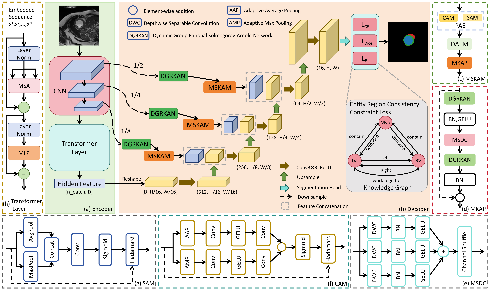

<h1 align="center">
  Structure-Aware Kolmogorov-Arnold Network with Anatomical Priors for Cardiac Segmentation
</h1>

  Song Lia,†,
  Shuaichao Dua,†,
  Xiaofeng Lib,*

  a School of Computer Science and Technology, Harbin University of Science and Technology, Harbin 150080, China
   
  b School of Information Engineering, Heilongjiang International University, Harbin 150025, China

  † These authors contributed equally to this work.
   
  * Corresponding author.

## Abstract

  Cardiac Magnetic Resonance imaging provides comprehensive morphological and functional information, making it the gold standard for cardiovascular diagnosis. However, the clinical deployment of deep learning models is hindered by challenges in handling data heterogeneity, balancing context aggregation with interpretability, and incorporating anatomical priors. To address these challenges, we propose the Structure-Aware Kolmogorov-Arnold Network, named SKANet. Specifically, a Dynamic Group Rational Kolmogorov-Arnold Network is integrated into skip connections to adaptively refine features against domain shifts. Furthermore, a Multi-scale Kolmogorov-Arnold Attention Module is devised to capture fine-grained contexts while improving model transparency. Additionally, we design an Entity Region Consistency Constraint Loss to explicitly incorporate anatomical priors for semantically consistent predictions. Extensive experiments are conducted on three diverse benchmark datasets (ACDC, MSCMRSeg, and M&Ms). On the ACDC dataset, SKANet achieves state-of-the-art performance, yielding a Dice score of 92.65% and an HD95 of 1.21 mm. Furthermore, zero-shot evaluations on the M&Ms dataset explicitly validate the framework's robust cross-domain generalization, while experiments on the MSCMRSeg dataset demonstrate its exceptional multi-sequence robustness and annotation-efficient capabilities. This paper indicates that SKANet provides a robust foundation for accurate cardiac segmentation across diverse pathologies and imaging protocols, which is crucial for standardized and reliable cardiovascular diagnosis.

## Framework Overview

<!-- Upload your architecture figure to figures/SKANet_framework.png. -->

  

  <strong>Fig. 1.</strong> Overview of the proposed SKANet.

## 🙋‍♀️ Feedback and Contact

Shuaichao Du: [2420410171@stu.hrbust.edu.cn](mailto:2420410171@stu.hrbust.edu.cn)

## 🛡️ License

This project is under the Apache-2.0 license. See LICENSE for details.
